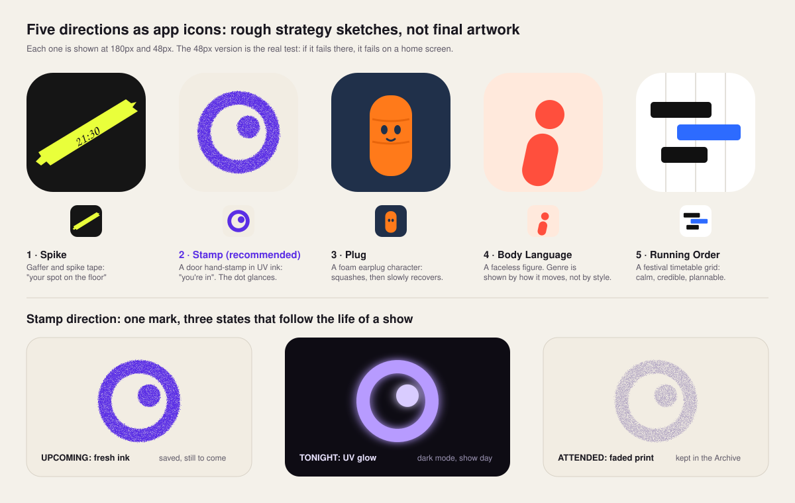

# Brand strategy and identity proposal: live music discovery app

*A strategy document for the founder. Prepared November 2026.*
*Sketch sheet: [`concept-sketches.svg`](./concept-sketches.svg). The sketches are rough strategy drawings, not final artwork.*

---

## 0. Executive summary (read this if nothing else)

1. **Recommended direction: Concept 2, "Stamp".** The identity is built on the ink stamp a venue puts on your hand at the door. It is the smallest ritual of live music, and every genre shares it. It says *you're in*. Every saved concert becomes a stamp. A stamp moves through three visual states that match the product's real data states. **Fresh ink** means upcoming. **UV glow** means tonight, and it is also the dark mode. **Faded print** means attended, kept in the Archive. In our judgement, the brand system and the product logic then become one thing, which a small team can afford to maintain. Weighted score: **8.3 / 10** (expert judgement, §6).
2. **No full mascot at launch.** A recurring character is the best-evidenced brand device we found. But the evidence comes from large-budget advertising, where repetition builds fame. A character also costs the most to keep consistent. DICE already uses a "fan" mascot in this exact category. And every character style hints at a genre, which works against your main constraint. Instead we recommend a **behavioural symbol**: the stamp mark has an off-centre dot that *glances* toward the direction you swipe. Research on anthropomorphism suggests that minimal motion cues are enough for people to read agency into a shape. You get much of a mascot's warmth at a fraction of the cost. If you still want a full character later, we specify the strongest candidate: a foam earplug (Concept 3, §5.2).
3. **The biggest strategic risk is not your logo.** Spotify already runs a free, taste-based *Live Events* feed inside an app your users open every day. Since Suno bought it in late 2025, Songkick sits inside an AI-music company. Your identity has to support a positioning Spotify cannot easily copy. We propose this one: **the deciding and remembering ritual of going out, not the listing**. That means a "maybe" state, plans, ticket links, and a lifetime archive. Stamp was chosen partly because it makes that ritual visible.
4. **Challenge to your brief:** stop describing the product as "Tinder for concerts" in public. The swipe is a mechanic, not a brand. The phrase brings dating associations and sets up a binary yes/no. Your own prototype already, and correctly, has three outcomes: Going, Deciding, Pass.

---

## 1. How to read this document

- **[Evidence]** marks a finding from published research or a primary or credible secondary source, with a link.
- **[Industry report]** marks claims by vendors or trade press that are useful but not independently verified.
- **[Our interpretation]** marks creative or strategic reasoning: professional judgement, not fact.
- All **scores are expert judgements**, not measurements. Before you commit money, test them with real users (§7.9 gives a cheap protocol).
- We did **not** invent statistics. Where a source was secondary or contested, we say so.

---

## 2. Phase 1: Research

### 2.1 What the case-study brands actually teach

| Brand | What they did | Transferable lesson [Our interpretation] |
|---|---|---|
| **Duolingo** | Its 2019 refresh with Johnson Banks made the owl rounder and far more expressive, so it can show "moods from excitement to menace". Alongside it came a custom typeface (Feather Bold, with Fontsmith) built from the owl's shapes, and tone-of-voice rules. The agency's diagnosis: the mascot worked, but the brand had no rules for use *outside* the app. [Industry report: [Creative Bloq](https://www.creativebloq.com/news/feather-bold)] Its TikTok fame came from the character reacting to trends rather than promoting the product. [Industry report: [Socialinsider](https://socialinsider.io/blog/duolingo-tiktok-strategy), [YPulse](https://www.ypulse.com/newsfeed/2021/12/14/thanks-to-unhinged-content-social-listening-and-a-trusty-mascot-duolingos-tiktok-strategy-is-helping-humanize-the-brand/)] | A character is worth having only when it has a **flaw or tension** to play with (Duo's passive aggression). It also needs **a whole system** around it: type, voice and rules. A cute owl alone did nothing. |
| **Reddit** | Pentagram's 2023 refresh kept Snoo at the centre and made it 3D and more expressive. It kept OrangeRed and added a conversation-bubble device and custom typefaces. [Industry report: [TechCrunch](https://techcrunch.com/2023/11/29/reddit-rebrand-refreshes-its-logo-as-ipo-speculation-swirls), [Pentagram](https://www.pentagram.com/work/reddit/story)] | Successful mascot brands **evolve their character rather than replace it**. Equity builds over time, which is why your first choice matters. |
| **Discord** | Its 2021 refresh simplified Clyde: symmetrical "ears", the shoulders removed so it reads as a head, the chat bubble container dropped, and a more saturated "blurple" (#5865F2). The font change drew user backlash. [Industry report: [Know Your Meme](https://knowyourmeme.com/news/discord-rebrand-criticized-by-users-over-new-logo-and-possible-accessibility-issues), [madegooddesigns](https://madegooddesigns.com/?p=57210)] | Marks get **simpler over time to work at small sizes**. Communities feel ownership, so changes need explaining. |
| **Mailchimp** | Collins (2018) kept Freddie but simplified him. It dropped the script wordmark for Cooper Light and made a single colour, Cavendish Yellow, the lead. The positioning was built on "unconventionality". [Industry report: [Creative Review](https://www.creativereview.co.uk/mailchimp-rebrand-by-collins/), [The Drum](https://www.thedrum.com/news/2018/09/27/mailchimp-plays-up-its-unconventionality-brand-and-ux-redesign)] | **One owned colour**, used with discipline, is the cheapest distinctive asset there is. Personality can come from illustration style and type as much as from a mascot. |
| **Headspace** | Its characters were never formal mascots. The logo is a plain orange circle, and the recognition comes from a **simple, rounded illustration system** with expressive faces. [Industry report: [Advertising Week](https://advertisingweek.com/aw360/news/unlocking-headspaces-inner-brand-character/19717/), [It's Nice That](https://www.itsnicethat.com/articles/italic-studio-headspace-graphic-design-project-250424)] | An **abstract symbol plus a rule-based visual system** can give character-like warmth without the cost and lock-in of one mascot. |
| **Spotify Wrapped** | It became a yearly cultural event built on **personal data turned into shareable cards**. Spotify reported that Wrapped engaged 245 million users. [Industry report: [Fortune](https://fortune.com/2025/12/04/spotify-wrapped-2025-less-about-ai/)] | Your strongest viral asset is probably **not your logo or mascot**. It is the user's own record of shows, formatted to be shown off. |

### 2.2 What makes a brand character or symbol memorable

**[Evidence] Distinctive assets need *fame* and *uniqueness*.** Jenni Romaniuk (Ehrenberg-Bass Institute) evaluates brand assets on two axes. *Fame*: do category buyers link the asset to your brand? *Uniqueness*: does it point *only* to you? ([Romaniuk, *Building Distinctive Brand Assets*, OUP 2018](https://marketingscience.info/building-distinctive-brand-assets/)) A study of over 400 assets found that marketers judge asset strength poorly: they tend to **overestimate fame and underestimate uniqueness** ([Marketing Week](https://www.marketingweek.com/marketers-judgement-strength-brand-assets-rarely-accurate/)).
→ *[Our interpretation]* For a new brand, fame is zero on day one. Choose assets that are **unique by construction**, then repeat them with discipline. A music note, a location pin or a ticket shape has no uniqueness in this category.

**[Industry report] Recurring characters ("fluent devices") correlate with effectiveness.** System1's analysis of IPA effectiveness data reports that campaigns with a fluent device were about 37% more likely to grow market share and 30% more likely to grow profit. It also reports that their use fell sharply over three decades ([System1](https://system1group.com/blog/the-seven-habits-of-highly-effective-characters), [IPA](https://ipa.co.uk/news/new-evidence-on-tangible-value-of-creativity)). These are **vendor-reported** figures from mostly large-budget TV advertisers.
→ *[Our interpretation]* This is the strongest argument *for* a mascot. Its limit: the benefit comes from **years of paid repetition**, which a small team does not have. A "fluent device" can also be a recurring *behaviour* or *ritual*, not only a creature.

**[Evidence] Repetition alone increases liking (mere exposure).** Zajonc (1968) and Bornstein's meta-analysis covering 1968–1987 ([*Psychological Bulletin* 106(2)](https://bvbvf1.bib-bvb.de/vufind/PrimoRecord/cdi_proquest_journals_614332207)) show that repeated exposure raises liking. The effect is moderated by stimulus complexity, duration and other factors.
→ *[Our interpretation]* Consistency beats novelty. The mark should appear at **every** meaningful moment in the product, not only on the splash screen.

### 2.3 Shape, proportion, face: what attracts attention

- **[Evidence] Baby schema.** Glocker et al. (2009) experimentally varied infant features: round face, high forehead, large eyes, small nose and mouth. Faces with more of these features were rated cuter and raised caretaking motivation ([*Ethology*](https://repository.upenn.edu/cog_neuro_pubs/11)). A companion fMRI study linked them to activity in the nucleus accumbens, a reward region ([PNAS PDF](https://www.cceb.upenn.edu/csa/assets/user-content/documents/PNAS-2009-Glocker.pdf)). Gould's essay on Mickey Mouse traces how Disney's character became more juvenile over decades ([*Natural History* 1979, reprinted](https://muse.jhu.edu/journals/ecotone/summary/v004/4.1-2.gould.html)).
- **[Evidence] Not all cuteness is the same.** Nenkov & Scott (2014, *Journal of Consumer Research*) separate *baby-schema* cuteness, which was linked in earlier work to carefulness, from *whimsical* cuteness. Whimsical cuteness primed fun and self-reward and led to **more indulgent choices** ([abstract](https://ideas.repec.org/a/oup/jconrs/doi10.1086-676581.html)).
  → *[Our interpretation]* For a "go out tonight" product, **whimsical, playful** cues fit the job better than baby-like helplessness. That is also why we avoid a soft, wide-eyed "baby" mascot: it reads childish to a 30-year-old metal or jazz fan.
- **[Evidence] Anthropomorphism needs only light cues, and it has to match.** Epley, Waytz & Cacioppo (2007) propose three drivers of anthropomorphism: accessible human knowledge, the motivation to understand an agent, and the need for social connection ([*Psychological Review*, PubMed](https://pubmed.ncbi.nlm.nih.gov/17907867/)). Aggarwal & McGill (2007) found that anthropomorphised products are liked more **when their humanlike features fit a coherent human schema**. A smiling car read as more human, and was rated higher, only for people who saw it as human ([*JCR*](https://econpapers.repec.org/RePEc:oup:jconrs:v:34:y:2007:i:4:p:468-479), [Chicago Booth Review](https://www.chicagobooth.edu/review/car-smiling-at-me)).
  *From our reference knowledge, not re-verified in this sprint:* Heider & Simmel (1944, *American Journal of Psychology*) showed that viewers attribute intentions and personalities to **simple moving triangles and circles**.
  → *[Our interpretation]* You do not need a face to create a character. **Motion is enough.** This underpins our "glancing dot" recommendation.
- **Round versus angular.** *From our reference knowledge, not re-verified:* the "bouba/kiki" effect (Köhler; Ramachandran & Hubbard 2001) shows people consistently match rounded shapes with soft sounds and spiky shapes with sharp ones. *[Our interpretation]* Rounded marks read as friendly. A small amount of irregularity, such as ink imperfection, keeps a round mark from feeling corporate.
- **Uncanny valley.** *From our reference knowledge:* Mori (1970) proposed that near-realistic humanoids can produce unease. *[Our interpretation]* Keep characters either clearly stylised or abstract. Avoid realistic 3D "almost-people".

### 2.4 Humour, playfulness and professionalism

- **[Evidence] Benign violation theory.** McGraw & Warren (2010, *Psychological Science*) argue that humour arises when something is **a violation and benign at the same time** ([PDF](https://leeds-faculty.colorado.edu/mcgrawp/pdf/mcgraw.warren.2010.pdf)).
  → *[Our interpretation]* Brand humour works when it breaks a small norm of concert life without hurting anyone. Examples: "the tall guy always stands in front of you", "the 'one more song' that's three more songs", "the setlist photo you'll never look at". Pointing humour at **shared fan rituals** is genre-neutral and safe. Pointing it at artists or genres is not.
- **The professional balance [Our interpretation].** Every successful example above uses a **two-register system**. Mailchimp is playful in illustration and sober in UI. Duolingo is chaotic on TikTok and orderly in lessons. For you: **expressive in moments** (swipe, save, the night of the show, sharing) and **calm in information** (dates, venues, prices, ticket links). People about to spend €40–€300 need credibility.

### 2.5 App-icon legibility

- **[Evidence/official guidance]** Apple's Human Interface Guidelines ask for "a recognizable, highly simplified design". They warn that detail clear at large sizes blurs at small ones, and advise against text and photos in icons ([Apple HIG: icons](https://developer.apple.com/design/human-interface-guidelines/icons.md)). Recent iOS versions also offer **dark and tinted** icon variants and layered icons, so a mark has to survive being reduced to a single tint.
- **[Our interpretation] Five practical tests:**
  1. The 48px squint test. See the sketch sheet.
  2. The silhouette test: the mark filled solid black.
  3. The tint test: single colour on dark.
  4. The grid test: next to Spotify, Instagram, DICE and Bandsintown on a real home screen.
  5. The 5-second recall test: show it, hide it, ask people to draw it.

### 2.6 Suitability for animation, memes and long-term growth [Our interpretation]

A brand asset spreads on social media when:

1. It can be **drawn by fans in 10 seconds**: a simple geometric base.
2. It has a **repeatable behaviour or catchphrase** that can be remixed, like Duo's "menace".
3. It can **react to culture without needing a script**. A neutral form can be placed into any trend.
4. It has an **obvious physical version**: plush, sticker, pin, tattoo, stamp.
5. It **doesn't require high-end 3D** to look right. That matters for cost.

### 2.7 Trends: what is working now and what is ageing

*All [Our interpretation], informed by the sources above.*

**Durable or working now:**
- Tactile, imperfect, "made by hands" textures (ink, print, tape, paper). They read as human in a feed full of AI-smooth imagery. DICE explicitly went "purposefully DIY" with a stick-and-poke-inspired logo ([It's Nice That](https://www.itsnicethat.com/news/patrick-duffy-dice-rebrand-graphic-design-040422)).
- Motion-first identities: the logo *does* something.
- Owned single colours and custom or characterful typography.
- Systems driven by the user's own data (Wrapped).

**Ageing or risky:**
- "Corporate Memphis" (flat, long-limbed people, Facebook's 2017 Alegria by Buck), now widely mocked as generic ([AIGA Eye on Design](https://eyeondesign.aiga.org/the-internet-is-turning-on-big-techs-colorful-corporate-mascots/), [Wikipedia overview](https://en.wikipedia.org/wiki/Corporate_Memphis)).
- Generic glossy 3D "blob" mascots.
- Purple-to-pink gradients and glassmorphism as identity rather than UI.
- Neon-on-black "nightlife" styling. It is the default code of the whole category (§3).
- Over-relying on "unhinged" mascot posting. Several commentators report diminishing returns, though our sources here were low-quality, so treat this as a weak signal.

---

## 3. Phase 2: Competitor analysis

| Player | Positioning (as we read it) | Visual codes | Where they're strong | Gap for you |
|---|---|---|---|---|
| **Spotify Live Events / "Concerts Near You"** | Concerts as an extension of listening. Free inside Spotify. *Concerts Near You* launched March 2025; Spotify reports 3M+ people used it ([Spotify Newsroom](https://newsroom.spotify.com/tag/concerts-near-you/)). The feed was redesigned with **venue following** in October 2025 ([Music Week](https://www.musicweek.com/live/read/spotify-users-can-now-follow-their-favourite-venues/092911)). | Spotify's own system (green, black, Circular type) | Distribution, listening data, zero friction | It is a *feature*, not a ritual. No "deciding" state, no going-out memory, tied to one streaming service, and ticketing usually via Live Nation/Ticketmaster per coverage. |
| **Songkick** | Track artists and get alerts. Acquired from WMG by **Suno** (AI music) in late November 2025, as part of a lawsuit settlement ([IQ](https://www.iqmagazine.com/?p=457150), [Music Business Worldwide](https://www.musicbusinessworldwide.com/suno-is-now-the-controller-of-songkick-user-data-and-is-hiring-a-gm-to-wire-it-into-its-ai-music-platform/), [Songkick FAQ](https://support.songkick.com/hc/en-us/articles/36545448038301-Songkick-and-Suno-Frequently-Asked-Questions)) | Pink-red, utilitarian | Huge tracking database, long history | **Trust and identity uncertainty.** Part of the core fan audience is sceptical of AI-generated music. A clearly *human, fan-made* brand has an opening. |
| **Bandsintown** | Artist-tracking utility, strong on the artist side | Teal/black, functional | Artist adoption and data | Low emotion: it feels like infrastructure. |
| **DICE** | Ticketing with a "fan-first" stance. 2022 in-house rebrand ("Be the Fan") with **a mascot called The Fan**, a sketchy diamond-shaped figure, and DIY, stick-and-poke-inspired graphics ([Design Week](https://www.designweek.co.uk/issues/4-10-april-2022/dice-rebrand/), [It's Nice That](https://www.itsnicethat.com/news/patrick-duffy-dice-rebrand-graphic-design-040422)) | Black/white, raw, hand-drawn | Cultural credibility, curation, fan-first anti-touting story | **This matters for you:** "a mascot that represents the fan" is already taken in your category. A fan-figure character would read as derivative. |
| **Resident Advisor (RA Guide)** | Electronic-music authority with an editorial voice ([Wikipedia](https://en.wikipedia.org/wiki/Resident_Advisor), [Design Week](https://www.designweek.co.uk/issues/january-2014/resident-advisor-launches-new-branding-and-site-design/)) | Black, minimal, editorial | Deep scene credibility | Single-genre by design. Shows the risk of an identity that codes one scene. |
| **Fever** | Curated "experiences" in cities, music being one category | Not researched in depth (our search returned nothing reliable) | City marketing machine | Not music-specialist. |
| **Ticketmaster / Live Nation** | Primary ticketing | Corporate blue | Inventory | Widely disliked by fans. Being *visibly unlike* it is an asset. |
| **TicketSwap** (Amsterdam) | Fan-to-fan resale, strong in NL | — | Dutch market familiarity | Resale, not discovery. A possible **partner**, not a rival. |
| **Greek market** (e.g. more.com, viva.gr) | Ticketing-led listings | Retail/e-commerce | Local inventory | No taste-based discovery layer that we found. |

### 3.1 Category code map [Our interpretation]

Almost everyone in live music uses some mix of:

- dark or black backgrounds with neon or glow
- photos of crowds with raised hands and stage lights
- music notes, waveforms and equalisers
- location pins
- ticket-stub shapes
- pink, magenta or purple gradients

A new brand built from these will register as "another concert app". That is high familiarity and zero uniqueness.

### 3.2 Differentiation opportunities

1. **Light, not night.** Almost nobody in this category leads with a *paper or daylight* base. A warm paper ground with one saturated ink colour would stand out on any home screen full of black icons.
2. **The ritual, not the listing.** Competitors sell *information* (dates) or *transactions* (tickets). Nobody owns the **emotional arc** of a show: wanting → deciding → going → remembering. Your product already contains Deciding and Archive.
3. **Human and fan-made, in a post-Suno moment.** Without being preachy, the brand can feel like it was made *by people who go to shows*.
4. **Genre neutrality through shared rituals.** Use what *every* gig has in common: the door, the queue, the stamp, the setlist, the earplugs, the walk home. Avoid any genre's aesthetic.

---

## 4. Phase 3: Five creative identity concepts

These are deliberately built on **five different identity types**:

1. A graphic system
2. A symbol with states
3. A character
4. A kinetic or behavioural identity
5. An information-design identity

See the [sketch sheet](./concept-sketches.svg).

---

### Concept 1: SPIKE (the backstage tape system)

**Central idea.** Every stage in the world is marked with *spike tape*, fluorescent gaffer strips that show performers where to stand. Every setlist is taped to the floor with gaffer tape. The brand says: *we'll mark your spot.* The identity is a **graphic system of torn tape strips and marker handwriting**.

**Emotion.** Insider access and anticipation: the feeling of seeing the stage before doors open.

**Visual language.**
- Fluorescent tape colours (yellow, pink, green, blue) on matte black or concrete grey.
- Handwritten marker type for times and set details, plus a clean grotesk for information.
- Torn edges; things "taped" onto cards.
- **Each genre family gets its own tape colour**, which adds variety without genre clichés.

**Symbol.** A single torn strip of tape, sometimes with a handwritten time on it.

**App icon.** A diagonal fluorescent strip on black. *Risk:* at 48px a diagonal strip can read as a slash or a checkmark (see sketch). Crossed strips read as an X, which clashes with "close", "pass" and the X brand.

**In the swipe experience.** Cards are "taped" to the screen. Swipe right and the tape peels off and the card sticks onto your setlist-style calendar. Swipe left and the card is untaped and falls. "Deciding" cards sit half-taped.

**Social and marketing.** Physical tape is cheap. You could tape your brand onto venue floors, lampposts and setlists. User-generated content: "tag your spot". Tape-strip stickers.

**Weaknesses and risks.**
- The DIY, hand-drawn register is close to DICE's current raw identity.
- Fluorescent on black is still "night" coding.
- Handwriting fonts age fast and can look cheap.
- The icon is ambiguous (see above).

**Long-term potential.** Medium-high. The system is robust and cheap, but it is **a style rather than an ownable symbol**. Imitators can copy it easily.

---

### Concept 2: STAMP (the door hand-stamp) ★ recommended

**Central idea.** When you walk into a show, someone presses an ink stamp on the back of your hand. It is the smallest, most universal sign that **you're in**. It is personal, a little rebellious and slightly temporary: you look at it the next morning and remember. The brand turns that ritual into the whole product.

- **Swiping right = getting stamped.**
- **Your calendar = your stamp sheet.**
- **Your archive = the stamps that have faded into memory.**

**Emotion.** Belonging ("I'm in"), anticipation, and the bittersweet "morning-after" memory.

**Visual language.**
- **Ground:** warm paper off-white in the daytime UI. It breaks the category's black-and-neon default.
- **Ink:** one owned, saturated **ultraviolet-violet**, the colour of UV stamp ink. Final colour to be checked against Twitch and Discord purples.
- **Texture:** real ink imperfection. Edge bleed, speckle, a slightly uneven press. The mark is *always* placed at a slight angle (about −8°), as a real stamp is.
- **Dark mode = UV mode.** On black, the ink *glows* the way UV stamps glow under club lights. Dark mode becomes a brand feature, not a colour inversion.
- **Information** set in a calm, highly legible grotesk with tabular figures. Ink is for emotion; the grid is for facts.

**The symbol: "the Glance".** A thick ink ring with a solid dot inside, set off-centre.
- At rest it reads abstractly: a speaker cone, a spotlight, an eye.
- It is a stamp that is also a little bit *someone*: the off-centre dot is a pupil looking sideways.
- In the product the dot **glances toward the direction you drag a card**. This is anthropomorphism through motion alone, with no face, no limbs and no character production pipeline.
- *Note:* this is a starting emblem. Once you choose a name, the stamp may also carry a short wordmark, the way real venue stamps do.

**The three stamp states (the core system):**

| Product state | Visual state | Meaning |
|---|---|---|
| Saved / Going (upcoming) | **Fresh ink**: crisp, saturated | "You're in." |
| Show day / tonight | **UV glow**: luminous on dark | "It's tonight." |
| Attended / Archive | **Faded print**: soft, partly missing | "You were there." |
| Deciding | **Half-pressed**: one edge missing ink | "Still thinking." |

**App icon.** The Glance in violet ink on a paper-coloured field, rotated slightly. In the dark or tinted variant it becomes a glowing ring. The silhouette is very simple and passes the 48px test (see sketch). *Watch-outs:* it can resemble a "Q", an eye logo or a donut. Distinctiveness comes from the **combination**: off-centre dot, ink texture, angle, violet on paper. Run a trademark search on the shape before launch.

**In the swipe experience.**
- Drag right: the Glance looks right and an ink stamp hovers over the card. Release: a heavy *thunk* (haptic impact), the stamp lands on the card's corner, and the card slides into your stamp sheet.
- Drag left: the Glance looks away and the card slides off. **No red X, no shame.** "Pass" is quiet.
- "Deciding" leaves a half-pressed stamp.
- A match reason appears as small stamped text: "Because you love *Artist X*". This supports credibility.

**Social and marketing.**
- **"Show us your stamp."** People already photograph hand stamps, so user content comes naturally.
- **Physical activation for very little money:** custom rubber stamps and UV ink for partner venues, merch desks, record shops and festival info points in Amsterdam, Utrecht, Athens and Thessaloniki. The brand ends up literally on thousands of hands. *Caveat:* door stamps are often a venue's re-entry security mark, so use merch desks and after-parties rather than the door unless the venue opts in.
- **The yearly "Hand"**: your Wrapped-style share card, with every show of the year overlaid as stamps on one hand or paper sheet.
- **The morning after:** a next-morning push ("Still buzzing? Your stamp's here.") with the setlist and photos. *[Evidence]* The peak-end rule suggests remembered experiences are weighted by their peak and their ending ([Fredrickson & Kahneman 1993 PDF](https://bear.warrington.ufl.edu/brenner/mar7588/Papers/fredr-kahneman-jpsp1993.pdf)). Owning the *ending* of the night is psychologically smart.

**Weaknesses and risks.**
- Hand stamps are more common in clubs and small venues than at stadiums and festivals, which use wristbands. The metaphor still travels: people understand it without having had one.
- "Stamps" also mean loyalty cards, passports and travel apps. Avoid any coffee-card "collect 10" mechanics.
- Violet sits near Twitch and Discord, so the exact hue must be checked.
- Ink texture has to be produced well. Cheap "grunge" brushes would undermine the premium feel.

**Long-term potential.** High. Brand extensions are physical (stamps, stickers, enamel pins, temporary tattoos). The state system grows with the product: tickets, friends' stamps, "first time seeing this artist" stamps. The mark can be anthropomorphised further later without a redesign.

---

### Concept 3: PLUG (a foam earplug character)

**Central idea.** The one object found at **every** kind of show, from metal to jazz to techno, is the humble foam earplug. Make it the brand's character: a squishy, slightly anxious, totally devoted gig-goer who **hates loud noise but loves live music**. That contradiction is the joke (a benign violation, §2.4), and it is endlessly meme-able.

**Emotion.** Affection, humour and care ("we look after you").

**Visual language.**
- A hot safety-orange foam body. Foam earplugs really are this colour, which gives an ownable colour code.
- Deep navy as a secondary colour.
- Soft matte "foam" texture.
- Squash-and-stretch motion that *literally belongs* to the material.

**Character.** A rounded cylinder with two simple dot eyes and a small mouth.
- **Signature animation:** it gets squashed, then **slowly re-expands**, as real foam does. That gives it a built-in comedic beat and a loading animation.
- Its moods map to genres without changing its look: braced for the metal show, bored-polite at the slow jazz set, vibrating at techno.

**App icon.** An orange capsule on navy. Very simple and readable at small sizes (see sketch).

**In the swipe experience.** The Plug peeks from the card edge and leans in the swipe direction. On "Going" it pops into your ears; on "Pass" it shrugs. In the empty state it sits in a cup at the bar.

**Social and marketing.** Highest meme potential of the five: *"me at the front row vs me in the back"*, *"POV: the drop"*. Partner with venues to hand out branded earplugs, which is useful, cheap and positive for hearing health. It suits creator collaborations and costumes.

**Weaknesses and risks.**
- Some people find earplugs a little "gross" (ear wax).
- It can read as a hearing-protection product.
- A character always risks feeling childish to part of the audience.
- It needs consistent illustration and animation production, the highest ongoing cost.
- It brings "it's too loud" energy into a joyful product.
- A mascot in this category invites comparison with DICE's The Fan, though the Plug is visually and conceptually different.

**Long-term potential.** High *if* funded. Characters build equity over years (Duolingo, Reddit). Without regular content, it becomes clip-art.

---

### Concept 4: BODY LANGUAGE (a kinetic, faceless figure)

**Central idea.** The key insight for a multi-genre brand: **genre lives in how the body moves, not in visual style.** Metal headbangs, techno bounces, jazz sways, pop jumps, folk stands still and beams. The identity is a single **faceless two-shape figure** (a circle head on a capsule body) whose *movement* changes with the music. It is the Heider-Simmel insight turned into a brand: personality comes from motion, not features.

**Emotion.** Recognition ("that's exactly how I dance at shows"), joy and inclusion.

**Visual language.**
- Warm coral or another single bright colour on a soft ground.
- Bold, flat geometry.
- A motion library of 10–15 genre "moves", each tied to a typical BPM.
- Very lightweight vector or Rive animation.

**Symbol.** The tilted figure.

**App icon.** The figure mid-move, tilted. *Risk:* static, it can read as a pictogram, a "person" icon or a lowercase "i" (see sketch). Without motion it loses most of its meaning.

**In the swipe experience.** The figure sits at the top of each card and **moves to the genre of the show**. Users learn to read a card from the movement before reading the text. Going: it jumps. Pass: it shrugs and walks off.

**Social and marketing.** "Which mover are you?" taste-type quizzes, genre-move GIF packs, and dance-trend participation. Users can make their own figure from their taste blend (a mix of moves).

**Weaknesses and risks.**
- Dances can stereotype scenes, so it needs careful, respectful movement design.
- The static icon is weak.
- Pictogram figures risk looking like signage or Corporate Memphis.
- Good motion design skills are required.

**Long-term potential.** Good. It is the most genre-inclusive idea. Its principle (genre expressed in motion) is worth borrowing even if this concept isn't chosen.

---

### Concept 5: RUNNING ORDER (festival timetable as an identity)

**Central idea.** Fans plan their nights and festivals on **timetables and clash-finders**: bars of time in a grid. The brand presents itself as the calm, beautifully organised planner of your live life. The logo is three offset bars, a slot in a running order.

**Emotion.** Control, confidence and the satisfaction of a perfect plan.

**Visual language.**
- Swiss-style grid, white or near-white, black type.
- **One electric accent colour** for "your" bars.
- Strong data typography: tabular figures, times, stage names.
- Coloured duration blocks as the main graphic device.

**Symbol.** Three bars offset like overlapping sets.

**App icon.** Offset bars on white. Clean and readable. *Risk:* it looks like a calendar or productivity app (see sketch).

**In the swipe experience.** Each card shows its time slot on a mini timeline. A swipe right "drops" the bar into your week. Clashes are shown visually.

**Social and marketing.** "My festival plan" share cards, clash memes ("when your two favourite bands play at the same time"). More useful than viral.

**Weaknesses and risks.**
- Low emotion.
- Easy to confuse with productivity tools.
- Appeals more to planners than casual fans.
- Not distinctive enough on its own.

**Long-term potential.** Long-lasting and credible, but probably remembered as a utility. Its **information discipline** should be borrowed by whichever concept wins.

---

## 5. Phase 4: Mascot strategy

### 5.1 Is a mascot strategically justified? Our answer: not as the launch identity

**For a mascot:**
- Recurring characters correlate with effectiveness [Industry report, §2.2].
- Mascots drive social content (Duolingo).
- They help build an emotional attachment that a utility otherwise lacks.

**Against, for this specific product and team:**
1. **Category saturation:** DICE already personifies "the fan" with a mascot. A fan-type character reads as a follower.
2. **Genre neutrality:** every drawing style (cute, gritty, sleek, retro) leans toward some scene. A playful creature can alienate metal, jazz and classical audiences who take their culture seriously.
3. **Cost and consistency:** a character needs expression sheets, poses, animation rigs, seasonal content and a guardian of the rules. Small teams usually under-produce it, and an under-produced mascot becomes clip-art.
4. **Fame takes money:** the evidence for characters comes from years of paid repetition.
5. **The product's emotional core is the user's own experience**, not the brand's personality. Wrapped shows that users' *own* data is the stronger hero.

**Better alternative: a behavioural symbol (the Glance).**
- An abstract mark that **behaves** like a character (it glances, gets pressed, glows, fades) without the production needs of one.
- *[Evidence-informed interpretation]* Minimal motion cues are enough to trigger attributions of intention (Heider & Simmel; Epley et al.).
- It can be upgraded into a fuller character later (small eyes, a squash, a wink) **without changing the logo**. It keeps that option open.

### 5.2 If you still want a full character: the Plug specification

Use this only if you can commit to **at least one new piece of character content a week**.

- **Silhouette:**
  - A capsule about 1:2 width to height, with slightly flattened ends (real earplugs are cylinders, not ovals).
  - The silhouette must read as a solid shape at 24px.
  - **No limbs** at launch. Arms appear only as "foam bulges" in key poses, which keeps it unique and cheap to animate.
- **Proportions:** eyes placed high, at about 35–40% from the top, which uses a mild baby schema without becoming babyish. A small mouth set low. No nose, no ears (the joke would be too meta).
- **Face:**
  - Two vertical-oval dot eyes and a single-stroke mouth.
  - Expressions come from **eye shape** (squint, wide, closed arcs, "X" for overwhelmed) and from **body squash**.
  - Six core expressions:
    - neutral-curious
    - braced
    - euphoric (squashed wide, eyes closed)
    - overwhelmed (squashed flat, spiral eyes)
    - bored-polite
    - tender (the last song)
- **Personality:**
  - An earnest, slightly anxious superfan who never misses a show despite being, literally, against loud noise.
  - A dry sense of humour; never mean about artists or genres.
  - Its flaw is that it's *too committed*.
- **Colour:**
  - Body in a single safety orange (pick one exact value and never vary it).
  - Navy for line and secondary elements.
  - No gradients; one soft shadow at most.
- **Simplicity rule:** if it can't be drawn in five strokes, it's off-model.
- **Animation:**
  - Squash/stretch, with the **slow foam recovery (about 600–900 ms ease-out)** as the signature beat.
  - Sways to tempo.
  - Pops into ears (a transition).
  - Can be rigged cheaply in Rive or Lottie.

---

## 6. Phase 5: Scoring and recommendation

> **All scores are expert judgements by our team on a 1–10 scale, not measured data.** Weights reflect your stated priorities: a small team, international, genre-neutral, distinctive. Validate with the user test in §7.9 before final commitment.

| Criterion | Weight | 1 Spike | 2 Stamp | 3 Plug | 4 Body Lang. | 5 Running Order |
|---|---:|---:|---:|---:|---:|---:|
| Memorability | 14% | 7 | 8 | 9 | 7 | 5 |
| Distinctiveness (vs category) | 14% | 8 | 9 | 9 | 7 | 6 |
| Emotional appeal | 12% | 6 | 8 | 8 | 8 | 4 |
| Broad demographic appeal | 10% | 8 | 8 | 6 | 9 | 8 |
| Visual versatility | 8% | 8 | 9 | 7 | 7 | 7 |
| App-icon effectiveness | 10% | 6 | 8 | 7 | 6 | 7 |
| Social / viral potential | 10% | 6 | 8 | 9 | 8 | 5 |
| Music-industry fit | 8% | 9 | 9 | 7 | 9 | 7 |
| Longevity | 7% | 8 | 8 | 7 | 8 | 9 |
| Production cost (10 = cheapest) | 7% | 9 | 8 | 5 | 6 | 9 |
| **Weighted total (/10)** | 100% | **7.37** | **8.30** | **7.64** | **7.48** | **6.40** |

**Reading the matrix.**
- **Stamp wins on balance.** It has no score below 8 and the best mix of distinctiveness, emotion and affordability.
- **Plug is the high-variance option.** It is the most memorable and viral, but the most expensive and the most divisive.
- If your team had budget for weekly content and a dedicated illustrator, the gap would narrow.
- The margins between concepts 1, 3 and 4 are within the uncertainty of expert judgement. Don't over-read them.

**Recommendation: Stamp, enriched by three borrowings:**
1. From **Body Language**: express genre through **motion**. The stamp "thunk" and the glow pulse can follow the tempo of the show's genre.
2. From **Running Order**: strict **information design** for all practical data.
3. From **Plug**: keep the **branded earplug** as a merch and partnership item, without making it a character.

---

## 7. Phase 6: Art direction brief for the winning concept (Stamp)

*Written for a professional illustrator or identity designer, or as structured input for an advanced image-generation model.*

### 7.1 Core brief

- **One sentence:** *A live-music discovery app whose identity is the ink stamp you get on your hand at the door: the sign that you're in.*
- **Personality:** warm, knowing, quietly playful, never loud. Like the friend who always knows what's on, not a promoter shouting.
- **Avoid:**
  - music notes, waveforms, equalisers, pins, crowd-with-hands photos
  - neon-on-black as the default
  - purple-to-pink gradients
  - flat Corporate Memphis people
  - grunge-brush "distressed" clichés
  - anything that codes one genre

### 7.2 Identity components

1. **The Glance (primary symbol):**
   - A thick ring (stroke about 38% of the radius) with a solid inner dot (about 33% of the radius).
   - The dot is offset about 30% of the radius toward the upper right at rest.
   - Always placed at **−8°**.
   - Supplied in three versions:
     - **Clean:** vector, for small sizes and UI.
     - **Inked:** textured, for brand moments.
     - **Glow:** for dark/UV mode.
2. **Ink texture kit:** 6–10 real scanned stamp impressions, made with an actual rubber stamp, UV ink and a few paper stocks. Vectorise some, keep others as PNG masks. **Make these physically.** It is cheap and avoids generic digital grunge.
3. **Colour (starting values, to be confirmed with contrast and competitor checks):**
   - *UV Ink* ≈ `#5A2EE5` (primary)
   - *Paper* ≈ `#F2EDE3` (light ground)
   - *Venue* ≈ `#0E0C14` (dark ground)
   - *Glow* ≈ `#B79BFF` (UV mode ink)
   - *Faded* ≈ `#7C6AA8` (archive)
   - *Signal* (one warm accent for "tonight / time-sensitive")
   - Check WCAG contrast for all text pairs.
4. **Typography:**
   - A sturdy, characterful grotesk for display. Explore typefaces with **ink traps**: the concept is literally about ink. An open-source option such as *Bricolage Grotesque* (Google Fonts) is a good budget test.
   - A highly legible UI sans with tabular figures for data.
   - A monospaced face for time, date and "stamped" labels.
   - Custom type can come later.
5. **Wordmark:** wait until the name is chosen. Brief: short (ideally ≤ 7 characters, so it can physically fit on a stamp), set in the display face, with an inked version for stamping.

### 7.3 Symbol "expression sheet" (in place of a character sheet)

Produce a sheet with the Glance in these states:
- at rest
- looking left
- looking right
- looking up ("what's on tonight?")
- half-pressed (Deciding)
- double-pressed (a show you're *very* excited about)
- smudged (a show was cancelled; handled gently)
- UV glow
- faded (attended)
- tiny "+1" dot beside it (a friend is going)

Each state must be recognisable at 32px.

### 7.4 Motion specification

| Moment | Motion | Timing (starting point) |
|---|---|---|
| Swipe-drag | Dot tracks the drag direction, with a slight ring stretch | Real-time, spring |
| Save (right swipe) | Stamp drops, squashes 6%, ink spreads, card slides to the sheet; heavy haptic | 180 ms in, 120 ms settle |
| Pass (left swipe) | Dot looks away, card slides off; light haptic, no stamp | 160 ms |
| Deciding | Half press, ink on one side only | 200 ms |
| Show day | Stamp in the list starts a slow UV pulse at the genre's tempo, capped for comfort | 1 pulse per bar |
| After the show | Next morning the stamp animates from glow to faded | 1.2 s, once |
| Loading | The Glance "looks around" (dot orbits the inside of the ring) | Loop of about 1.5 s |

Respect *Reduce Motion*: replace motion with cross-fades. **Tools:** Rive, whose state machines suit the Glance tracking a drag, or Lottie for simple loops.

### 7.5 App icon specification

- **Master:** 1024 × 1024. Paper field with the inked Glance in UV Ink at −8°, optically centred (nudge slightly down and left to balance the offset dot).
- **Variants:**
  - **dark:** Glow version on Venue black
  - **tinted:** single-tone silhouette, clean version
  - **Android adaptive:** foreground and background layers
- **Test sizes:** 29, 40, 60, 76 and 180 px. Test on real devices against a home screen with Spotify, Instagram, DICE and Bandsintown.
- **No text** in the icon.

### 7.6 Mobile UI mockups to commission

Briefs for a UI designer:

1. **Onboarding:**
   - Taste selection with chips that get stamped as you choose them.
   - Final screen: a big stamp lands with "You're in."
2. **Discover deck (the hero screen):**
   - Card: artist image top (about 55%), artist name in display type, then a stamped date and venue line.
   - "Because you love…" reason, then price and ticket info.
   - Glance at the top centre watching your drag.
   - Three actions at the bottom: Pass · Deciding · Going.
3. **Event detail:**
   - Strict information grid: date, doors, set time, venue map link, lineup, ticket links, source credibility notes.
   - Ink only at the top.
4. **Stamp sheet (calendar):**
   - A month view where each saved show is a small stamp.
   - Tap to expand. "Tonight" glows.
5. **Archive:** faded stamps, year totals, "most seen artist", city count. This feeds the yearly share card.
6. **Share card (9:16):**
   - "I was there", with the stamp, artist, venue and date.
   - A yearly "Hand" version with all of the year's stamps overlaid.
7. **Empty and error states:**
   - No shows nearby: the Glance looks around.
   - Offline: an ink-dry stamp.

### 7.7 Sample prompts for image-generation models (for exploration only)

> *Use these to explore mood, not to produce final logos. AI output should not be the final trademarked mark: ownership and originality need a human designer and a trademark check.*

1. *"Macro photograph of a violet UV ink rubber-stamp impression on the back of a hand under a club's blacklight. The stamp is a simple thick ring with an off-centre solid dot, slightly smudged, glowing faintly. Shallow depth of field, real skin texture, documentary style, no text."*
2. *"Mobile app UI mockup, iPhone, warm off-white paper background, a concert card with a large artist photo, bold grotesk headline, small monospaced date line stamped in violet ink, a circular violet ink stamp mark tilted −8° in the card corner. Clean editorial layout, generous spacing, realistic device frame."*
3. *"Flat-lay of brand merchandise: custom rubber stamp with a ring-and-offset-dot emblem, violet ink pad, stickers, enamel pin and a printed gig calendar on warm paper. Natural daylight, minimal styling."*
4. *"Dark-mode mobile screen, near-black background, a list of concerts tonight with glowing violet ring stamps beside each, subtle UV glow, crisp white typography."*

### 7.8 Production plan for a small team

*The cost ranges below are our rough planning estimates, not quotes.*

| Phase | Deliverable | Who | Rough effort/cost |
|---|---|---|---|
| 0 | Name shortlist and trademark pre-check (affects wordmark and stamp) | Founder + naming freelancer | 2–4 weeks |
| 1 | Glance mark refinement, colour, type, icon, ink kit | One freelance identity designer | 3–5 weeks; low thousands to around €10k depending on seniority |
| 2 | Rive animations (drag glance, stamp, glow, fade) | Motion freelancer or in-house dev | 1–2 weeks |
| 3 | UI kit applied to the existing app | In-house | Ongoing |
| 4 | Physical rubber stamps, UV ink, stickers | Local print shop | Low hundreds of euros |
| 5 | Share cards, launch campaign | In-house + freelancer | 2 weeks |

### 7.9 Cheap validation protocol before committing (recommended)

1. **Five-second recall:** show each of the five icons to 20–30 target users (NL and GR, mixed genres) for 5 seconds. Next day, ask them to sketch any they remember.
2. **Home-screen grid test:** place each icon among 20 real music apps and time how fast people find it.
3. **Genre fit:** ask "Who is this app for?" If a large share of answers names one genre, the concept fails neutrality.
4. **Fame/uniqueness proxy** (after soft launch): ask category users which brand an asset belongs to, following Romaniuk's logic (§2.2).

Run the tests with prototypes in a tool like Figma. Don't pay for final design until the winner holds up.

---

## 8. Assumptions we challenge

1. **"Tinder-style" positioning.** Keep the mechanic, drop the comparison. It brings dating associations and implies a binary choice. Your product's three-way decision (Going / Deciding / Pass) is more honest about how people decide on a €60 ticket, and more ownable.
2. **"Discovery" is not the moat.** Spotify does taste-based concert discovery for free, at scale. Your defensible ground is the **full arc**: decide → plan → go → remember, plus small-venue coverage that big platforms miss. The identity should celebrate *going and remembering*, not just "finding".
3. **Name and identity are not independent.** You asked us not to name it, and we haven't. But a stamp-based identity favours **short, stampable names**. Brief your naming work with that constraint, or the two will fight.
4. **The Netherlands and Greece are different markets.** English works well for both youth audiences, but Greek users may expect local ticketing partners and Greek-language support for practical details. A strongly *visual*, low-copy identity like the stamp travels better than a joke-heavy, English-copy one like the Plug.
5. **Your current prototype's look.** The existing "Listening Mirror — Live" UI uses a well-made dark/ember editorial style (Instrument Serif, ember accent). It is tasteful, but it sits inside the category's "night" code. If you adopt Stamp, the ember warmth can survive as the *Signal* accent for "tonight".
6. **Hearing health is a quiet opportunity.** Whichever concept you pick, a branded earplug partnership is cheap, useful and builds goodwill. It doesn't need to be the mascot to work.

---

## 9. Sources

**Psychology and marketing science**
- Glocker et al. (2009), *Baby schema in infant faces induces cuteness perception and motivation for caretaking in adults*, Ethology — https://repository.upenn.edu/cog_neuro_pubs/11 ; PNAS fMRI companion — https://www.cceb.upenn.edu/csa/assets/user-content/documents/PNAS-2009-Glocker.pdf
- Gould, *Mickey Mouse meets Konrad Lorenz* (Natural History, 1979; reprinted) — https://muse.jhu.edu/journals/ecotone/summary/v004/4.1-2.gould.html
- Nenkov & Scott (2014), *"So cute I could eat it up"*, Journal of Consumer Research — https://ideas.repec.org/a/oup/jconrs/doi10.1086-676581.html
- Epley, Waytz & Cacioppo (2007), *On seeing human*, Psychological Review — https://pubmed.ncbi.nlm.nih.gov/17907867/
- Aggarwal & McGill (2007), *Is that car smiling at me?*, Journal of Consumer Research — https://econpapers.repec.org/RePEc:oup:jconrs:v:34:y:2007:i:4:p:468-479 ; summary — https://www.chicagobooth.edu/review/car-smiling-at-me
- McGraw & Warren (2010), *Benign violations*, Psychological Science — https://leeds-faculty.colorado.edu/mcgrawp/pdf/mcgraw.warren.2010.pdf
- Bornstein (1989), *Exposure and affect: overview and meta-analysis*, Psychological Bulletin — https://bvbvf1.bib-bvb.de/vufind/PrimoRecord/cdi_proquest_journals_614332207
- Fredrickson & Kahneman (1993), *Duration neglect in retrospective evaluations*, JPSP — https://bear.warrington.ufl.edu/brenner/mar7588/Papers/fredr-kahneman-jpsp1993.pdf
- Romaniuk, *Building Distinctive Brand Assets* (OUP 2018) — https://marketingscience.info/building-distinctive-brand-assets/ ; Marketing Week on asset misjudgement — https://www.marketingweek.com/marketers-judgement-strength-brand-assets-rarely-accurate/
- System1 / IPA on fluent devices (vendor-reported) — https://system1group.com/blog/the-seven-habits-of-highly-effective-characters ; https://ipa.co.uk/news/new-evidence-on-tangible-value-of-creativity
- From reference knowledge, not re-verified in this sprint: Heider & Simmel (1944), *An experimental study of apparent behavior*, American Journal of Psychology 57(2); Ramachandran & Hubbard (2001), *Synaesthesia: a window into perception, thought and language*, Journal of Consciousness Studies 8(12); Mori (1970), *The uncanny valley*.

**Brand case studies**
- Duolingo: https://www.creativebloq.com/news/feather-bold ; https://socialinsider.io/blog/duolingo-tiktok-strategy ; https://www.ypulse.com/newsfeed/2021/12/14/thanks-to-unhinged-content-social-listening-and-a-trusty-mascot-duolingos-tiktok-strategy-is-helping-humanize-the-brand/
- Reddit / Pentagram: https://techcrunch.com/2023/11/29/reddit-rebrand-refreshes-its-logo-as-ipo-speculation-swirls ; https://www.pentagram.com/work/reddit/story
- Discord: https://knowyourmeme.com/news/discord-rebrand-criticized-by-users-over-new-logo-and-possible-accessibility-issues ; https://madegooddesigns.com/?p=57210
- Mailchimp / Collins: https://www.creativereview.co.uk/mailchimp-rebrand-by-collins/ ; https://www.thedrum.com/news/2018/09/27/mailchimp-plays-up-its-unconventionality-brand-and-ux-redesign
- Headspace: https://advertisingweek.com/aw360/news/unlocking-headspaces-inner-brand-character/19717/ ; https://www.itsnicethat.com/articles/italic-studio-headspace-graphic-design-project-250424
- Spotify Wrapped: https://fortune.com/2025/12/04/spotify-wrapped-2025-less-about-ai/
- Corporate Memphis: https://eyeondesign.aiga.org/the-internet-is-turning-on-big-techs-colorful-corporate-mascots/ ; https://en.wikipedia.org/wiki/Corporate_Memphis
- Apple HIG, icons: https://developer.apple.com/design/human-interface-guidelines/icons.md

**Competitors**
- DICE rebrand: https://www.designweek.co.uk/issues/4-10-april-2022/dice-rebrand/ ; https://www.itsnicethat.com/news/patrick-duffy-dice-rebrand-graphic-design-040422
- Songkick / Suno: https://www.iqmagazine.com/?p=457150 ; https://www.musicbusinessworldwide.com/suno-is-now-the-controller-of-songkick-user-data-and-is-hiring-a-gm-to-wire-it-into-its-ai-music-platform/ ; https://support.songkick.com/hc/en-us/articles/36545448038301-Songkick-and-Suno-Frequently-Asked-Questions
- Spotify Live Events: https://newsroom.spotify.com/tag/concerts-near-you/ ; https://www.musicweek.com/live/read/spotify-users-can-now-follow-their-favourite-venues/092911
- Resident Advisor: https://en.wikipedia.org/wiki/Resident_Advisor ; https://www.designweek.co.uk/issues/january-2014/resident-advisor-launches-new-branding-and-site-design/
- Bandsintown: https://www.hypebot.com/cellfish-media-rebrands-as-bandsintown-group/

*Limitations: competitor colour descriptions not confirmed by official brand guidelines were left out or marked. We did not have access to proprietary app-store analytics or user research. All concept scores are judgements to be validated.*
